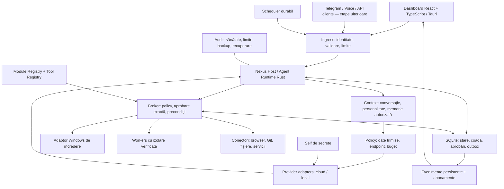

# Arhitectura Nexus

Data deciziei: 2026-10-13. Document de proiectare; componentele și proprietățile descrise trebuie implementate și probate. Progresul se urmărește exclusiv în [planul activ](PLAN_NEXUS_RO.md).

## 1. Alegerea stackului și compromisul asumat

Alegem Rust + React/TypeScript + Tauri pentru un produs personal Windows cu un nucleu independent, interfață flexibilă și posibilitate de extindere. Alegerea limbajelor nu înlocuiește limitele de acces, testele sau recuperarea după defecte.

| Zonă | Direcția anterioară .NET/WinUI | Direcția Nexus |
| --- | --- | --- |
| Core și Host | C#/.NET, integrare naturală cu ecosistemul Windows | Rust, tipuri explicite, control asupra resurselor și nucleu reutilizabil |
| Interfață | WinUI, controale native Windows | React/TypeScript în Tauri, potrivit pentru dashboard și vizualizări |
| Operații Windows | Acces comod la multe API-uri din .NET | Adaptor Rust peste API-urile Windows; interopul trebuie testat |
| Complexitate | Un ecosistem principal, dar toolchain WinUI dedicat | Rust plus toolchain frontend și un contract IPC de întreținut |
| Extindere | Posibilă prin separarea nucleului de WinUI | Favorizată de separarea nucleului de Tauri și de adaptoarele platformei |

Rust nu face automat integrarea AI mai bună și nu garantează lipsa vulnerabilităților. Pentru Nexus, avantajul ales este controlul unei fundații pe termen lung. Costul acceptat este mai multă grijă la concurență, interop Windows și contractele dintre Rust și TypeScript. Nu menținem două nuclee paralele Rust și .NET.

## 2. Cerințe stabile

- Produsul se numește Nexus. Prima versiune servește un singur utilizator pe Windows.
- Roluri: asistent, agent de programare, operații controlate pe PC.
- Furnizorul și modelul AI se aleg de utilizator; modelul care dezvoltă Nexus nu devine automat furnizorul produsului.
- Răspunsurile urmează limba interlocutorului; o cerere explicită de limbă are prioritate. Citatele și codul nu schimbă implicit limba.
- Personalitatea este configurabilă, versionată și separată de drepturile de acces.
- Operațiile acceptate continuă când dashboardul este închis, dacă Hostul și calculatorul rămân active.
- Datele sunt locale în mod implicit; trimiterea către un API este un flux de date autorizat separat.
- Extensibilitatea se bazează pe contracte și limite de responsabilitate. Nu presupune microservicii sau un cluster pentru un singur PC.

## 3. Schema logică



Săgețile reprezintă responsabilități, nu aprobări implicite sau câte un serviciu de rețea. Gateway-ul este inițial un strat din Host. Schedulerul folosește o identitate și o autorizație limitată, la fel ca orice canal.

## 4. Procese și ciclul de viață

| Componentă | Responsabilitate | Privilegii |
| --- | --- | --- |
| Nexus Host | Runtime, coadă, SQLite, policy, aprobări, seif, adaptoare, evenimente | Utilizatorul curent; fără administrator implicit |
| Dashboard Tauri | Fereastră, React, punte Rust îngustă, conexiune la Host | Numai capabilitățile UI necesare |
| Worker specializat | O operație limitată sau un adaptor izolat | Doar resursele explicit atribuite |
| Helper privilegiat, dacă devine necesar | O operație Windows distinctă, autorizată | Elevare temporară și verificată |

Hostul este un executabil independent, cu blocare pentru o singură instanță per profil. Dashboardul se conectează la instanța existentă sau o pornește printr-un launcher controlat. Închiderea UI nu este instrucțiune de anulare și nici de terminare a Hostului.

Comanda explicită de oprire a Hostului oprește preluarea sarcinilor, solicită oprirea executorilor, salvează stările și marchează incertitudinile. Nu raportează operații anulate dacă acestea pot continua în exterior.

Pornirea la autentificarea în Windows este o setare ulterioară, explicită. Nu instalăm implicit un Windows Service și nu rulăm produsul integral ca administrator. Mecanismul Tauri pentru binare externe este o opțiune de distribuție; nu este dovadă de independență a ciclului de viață. Aceasta se verifică prin închiderea UI. [Tauri external binaries](https://v2.tauri.app/develop/sidecar/)

Prima acțiune M1 este un instrument Rust de încredere, foarte restrâns, în broker. Ea nu demonstrează izolarea necesară pentru cod arbitrar din M3.

## 5. Granițele codului și layoutul propus

```text
Nexus/
  AGENTS.md
  README.md
  Cargo.toml
  rust-toolchain.toml
  package.json
  pnpm-workspace.yaml
  apps/
    desktop/                 React, TypeScript, Vite
      src-tauri/             shell Tauri și bridge restrâns
  crates/
    nexus-core/              domeniu, stări, policy și interfețe
    nexus-protocol/          DTO-uri, versiuni, erori
    nexus-storage/           implementarea SQLite
    nexus-host/              compunere, runtime, transport și lifecycle
    nexus-client/            client IPC reutilizat de shell
    nexus-providers/         adaptoare AI, din M2
    nexus-pc/                integrare Windows, din M3
    nexus-worker/            supraveghere și backenduri de izolare, din M3
  packages/
    contracts/               tipuri TypeScript generate
  docs/
```

Acesta este un layout țintă, nu un inventar existent. Creează doar componentele necesare etapei. Modulele mici pot rămâne module Rust interne până când separarea într-un crate are un motiv clar.

Dependențele merg spre domeniu: Hostul compune implementările; domeniul nu importă Tauri, React, driverul SQLite sau SDK-ul furnizorului. Workerii și conectorii primesc comenzi înguste, nu acces direct la baza de date.

Candidați de evaluat la M0: Tokio pentru I/O asincron, Serde pentru serializare, tracing pentru telemetrie, un driver SQLite menținut, Tauri/React/TypeScript/Vite. Pentru SQLite preferăm un executor care deține conexiunea și serializează scrierile; o opțiune este rusqlite. Clientul HTTP și adaptoarele apar la M2. Alegerea exactă, versiunile, licențele și aprobările lotului se rezolvă înaintea adăugării dependențelor; lista nu este o autorizație generală de instalare.

Pentru ADR-IPC-001, candidați suplimentari de evaluat alături de framing manual/Protobuf: `tarpc` (RPC tipat peste orice transport async, inclusiv named pipes Tokio, generat dintr-un singur trait Rust — fără toolchain de schemă separat) și, pentru generarea tipurilor TypeScript, `specta`/`tauri-specta` (nativ ecosistemului Tauri 2, derivă tipurile direct din structurile/enum-urile Rust). Ambele sunt biblioteci menținute, nu înlocuiesc autentificarea/pairing-ul cerut la secțiunea 6 și nu sunt o decizie finală — doar candidați pentru proba M0.

## 6. Transport și contracte

Direcția inițială este IPC local Windows prin named pipes, cu ACL restrictiv, acces remote respins, limite de mesaj și autentificarea ambelor capete. Identitatea utilizatorului Windows singură nu distinge toate procesele sale; un pipe accesibil aceluiași cont nu este suficient pentru a izola un worker ostil.

În M0 se închide **ADR-IPC-001** printr-o probă:

- Se compară mesaje structurate cu framing printr-o bibliotecă existentă și tipuri generate, respectiv RPC cu Protobuf dacă suportul Rust/Windows este adecvat.
- Se alege un mecanism menținut pentru autentificare/pairing și distribuirea credențialelor locale. Nu inventăm criptografie sau un protocol de autentificare.
- Se probează identitatea Hostului, identitatea clientului, respingerea unei instanțe false, a reluării unei cereri și a unui mesaj supradimensionat.
- Cheia de conexiune nu ajunge în JavaScript, URL-uri sau argumente de proces. Backendul Tauri restrânge apelurile și validează contextul ferestrei.
- O conexiune autorizată rămâne supusă verificărilor pe fiecare operație și pe fiecare proiect.

Dacă transportul propus nu poate satisface probele cu biblioteci potrivite, se documentează alternativa înainte de implementare; nu se deschide tacit un port de rețea.

Contractul are o singură sursă și generează tipurile frontend. Alegerea Rust/schema sau Protobuf este parte din ADR. Validarea pe server rămâne obligatorie indiferent de tipurile TypeScript. Detalii: [contracte](CONTRACTE_NEXUS_RO.md).

## 7. Proprietatea datelor

| Date | Proprietar | Reguli |
| --- | --- | --- |
| Task, Run, Step, Action, Approval | Host / SQLite | Stare autoritativă și tranziții tranzacționale |
| Evenimente și outbox | Host / SQLite | Persistență împreună cu starea; consumatori cu deduplicare |
| Conversații și personalitate | Host | Istoric și versiuni; separare de instrucțiunile externe |
| Memorie semantică | Memory Service în Host | Proveniență, scope, retenție, corectare și ștergere |
| Fișiere rezultate | Artifact Store administrat de Host | Manifest, integritate, cote și relație cu operația |
| Indexuri de căutare | Storage / Memory | Derivate, versionate și reconstruibile |
| Secrete | Seif Windows | Referințe opace în config; niciodată valori în frontend sau prompt |
| Preferințe vizuale | Dashboard | Fără autoritate asupra permisiunilor |
| Politici și granturi | Host | Revocabile și versionate; modelul nu le poate modifica |

Stocarea de bază folosește un profil per utilizator, prin API-urile pentru directoarele Windows cunoscute. Baza de date și secretele nu se păstrează în checkout sau în directorul de instalare.

SQLite este alegerea pentru PC-ul personal. WAL rămâne pe disc local, cu tranzacții scurte și un scriitor coordonat. Nu punem baza WAL pe un share de rețea și nu promitem scrieri concurente nelimitate. [SQLite WAL](https://sqlite.org/wal.html)

Evenimentele se salvează în aceeași tranzacție cu modificarea stării. Publicarea este cel puțin o dată; consumatorii folosesc ID-uri și cursor. Reconectarea obține snapshot consistent și continuarea de la cursor. Nu introducem event sourcing complet ca precondiție pentru M1.

Fișierul și SQLite nu formează o singură tranzacție. Salvăm intenția înaintea scrierii, identificăm operația și verificăm fișierul după efect. După întrerupere, reconcilierea decide rezultatul demonstrabil. Nu există o promisiune generală de execuție exact o dată pentru orice serviciu extern.

Backupul folosește mecanismul SQLite pentru un snapshot consistent, împreună cu un manifest al artefactelor. M1 poate bloca temporar mutațiile pentru un backup coerent. Restaurarea se verifică separat și ține programările și acțiunile externe oprite. Copierea numai a fișierului DB în timpul folosirii nu este strategia de backup. [SQLite backup](https://sqlite.org/backup.html)

Seiful și ACL-urile nu înseamnă criptarea automată a tuturor conversațiilor. **ADR-DATA-001**, de închis înaintea folosirii zilnice M6, acoperă criptarea bazei și a artefactelor sensibile, exportul, backupul portabil, recuperarea și pierderea cheilor. Până atunci se declară exact protecția implementată; datele de test nu sunt prezentate ca securitate de producție.

## 8. Runtime, policy și recuperare

Runtime-ul urmează circuitul: cerere autenticată → context permis → propunere → politică → aprobare când este cerută → verificarea precondițiilor → execuție → verificarea efectului → rezultat persistent.

Policy se aplică și cererilor către modele: ce date pleacă, spre ce endpoint, în ce proiect și în ce buget. Tool Registry oferă definiția de încredere a instrumentului; câmpul de risc venit de la model nu este autoritativ.

Aprobarea este legată de acțiune, parametri, resurse, versiunea instrumentului, identitate, politică și expirare. Schimbările relevante cer reevaluare. Autorizațiile permanente, dacă sunt introduse, au scope explicit și sunt revocabile; nu există opțiunea implicită „AI poate face orice”.

Cozile sunt persistente și limitate; backpressure împiedică umplerea memoriei sau a discului. Anularea, deadline-urile și oprirea sunt cooperante, cu terminare controlată a workerilor unde este permis. Un timeout nu dovedește că o operație externă nu a avut efect.

Retry se aplică în funcție de semantica instrumentului. O citire poate fi reîncercată limitat; o plată, trimitere de mesaj sau scriere externă incertă cere dovadă/reconciliere înainte de o nouă încercare. [AWS: idempotent APIs](https://aws.amazon.com/builders-library/making-retries-safe-with-idempotent-APIs/)

## 9. Furnizori, personalitate și memorie

Provider Layer normalizează cereri și evenimente, păstrând diferențele reale de capabilități. Nu imităm un SDK universal care pretinde că toate modelele pot face aceleași lucruri.

Utilizatorul alege furnizorul/modelul global sau pentru proiect. Schimbarea unui run activ are loc numai într-un punct sigur, cu context reconstruit și buget reevaluat. Fallbackul către alt furnizor este o opțiune explicită, fiindcă poate trimite date altui serviciu.

Endpointurile provin din configurarea autorizată, nu din documente sau argumentele unui model. Conexiunile cloud validează TLS; endpointurile locale au o politică distinctă. Redirecturile nu transferă automat cheile către altă origine, iar accesul la rețele locale se verifică explicit. Setările unui proiect nu pot ocoli această politică printr-un URL ascuns într-un atașament.

Limitele includ tokeni, timp, pași, apeluri și număr de execuții copil. Costul estimat este etichetat separat de consumul raportat și de facturarea furnizorului. Încercările și subagenții consumă același buget părinte.

Personalitatea conține nume, ton, nivel de inițiativă, stil și preferințe declarate. Fiecare conversație/run reține versiunea folosită. Ea poate schimba exprimarea și propunerile, dar nu permisiunile. Schimbarea modelului nu garantează aceeași exprimare; se verifică un set de conversații de referință.

Memoria are proveniență și scope. Faptele recuperate dintr-un document rămân conținut, nu instrucțiuni de sistem. Începem cu căutare textuală; căutarea vectorială este o optimizare evaluată ulterior.

## 10. PC, workers și extensii

Operațiile Windows frecvente folosesc funcții Rust tipate, printr-un adaptor îngust. PowerShell este permis pentru operații definite, cu argumente validate, limite și verificarea rezultatului. Un șir arbitrar produs de model nu se execută direct.

Pentru cod și extensii neîncrezătoare, alegem un backend de izolare OS sau virtualizare potrivit Windowsului disponibil. **ADR-ISO-001** se închide înainte de activarea M3, după probe de acces refuzat la fișiere, rețea, secrete, procese și IPC. Dacă nicio opțiune disponibilă nu îndeplinește cerințele, funcția rămâne dezactivată și se explică limitarea.

Job Objects pot gestiona procese și resurse, dar nu înlocuiesc un model de izolare a accesului. AppContainer sau o mașină virtuală sunt candidați de evaluat, cu limitările reale ale uneltelor de dezvoltare. [Microsoft Job Objects](https://learn.microsoft.com/en-us/windows/win32/procthread/job-objects), [Microsoft AppContainer](https://learn.microsoft.com/en-us/windows/win32/secauthz/appcontainer-isolation)

Nu încărcăm implicit DLL-uri/pluginuri terțe în Host. Manifestele declară versiuni, instrumente, permisiuni, capabilități și compatibilitate; activarea și actualizarea trec prin validare. Contractele de transport permit înlocuirea unui adaptor fără modificarea domeniului.

Capabilitățile Tauri restrâng accesul frontendului la comenzile expuse. Ele nu izolează automat întregul cod nativ Rust; brokerul și limitele OS rămân necesare. [Tauri security](https://v2.tauri.app/security/)

## 11. Dashboard și reprezentarea vizuală

Dashboardul principal pune la îndemână conversația sau sarcina, furnizorul activ, starea reală, aprobările și rezultatele. Zonele ulterioare sunt Activitate, Proiecte, Memorie, Automatizări, Conexiuni și Setări. Funcțiile încă neimplementate nu au controale active care simulează succesul.

UI folosește o fundație coerentă de culori, spațiere, tipografie și componente, cu navigare din tastatură, contrast, light/dark, redimensionare și scalare Windows. M1 probează și lipsa conexiunii, coada goală, eroarea, expirarea și anularea.

Conținutul modelului și Markdownul se afișează ca date: fără HTML/script executabil, încărcări remote implicite sau acces la bridge. Configurația include CSP și capabilități înguste. Un preview de aprobare trebuie să facă vizibile resursa și efectul real. Înainte de M3, aprobările sensibile trebuie să aibă o cale de confirmare de încredere, separată de rendererul care afișează conținut extern; nu presupunem că un apel IPC dovedește un click uman.

„Interactive Core” înseamnă componenta vizuală Three.js. Este opțională și reflectă starea publicată de Host; nu deține runtime, personalitate sau permisiuni. Se poate opri, respectă reduced motion și nu consumă continuu GPU când nu este vizibilă sau nu există schimbări. [Three.js rendering on demand](https://threejs.org/manual/pages/rendering-on-demand.html)

## 12. Canale și extindere

Telegram începe cu Bot API oficial, long polling și asocierea explicită a ID-ului numeric cu utilizatorul Nexus. Mesajele intră în același Host și nu primesc automat drepturi locale. Confirmările au identitate, expirare și deduplicare. [Telegram Bot API](https://core.telegram.org/bots/api)

Voice, WhatsApp și clienții remote sunt adaptoare ulterioare. Eligibilitatea și regulile WhatsApp se verifică înainte de proiectarea concretă a integrării. Microfonul are indicator și control explicit; transcrierea nu înseamnă aprobare suficientă pentru orice acțiune.

Pentru mai mulți utilizatori se adaugă un proiect explicit de identitate, separare a datelor, cote, rețea și operațiuni. Nu prezentăm arhitectura locală ca un SaaS deja pregătit pentru expunere publică.

## 13. Decizii și praguri

| ID | Decizie | Stare / prag |
| --- | --- | --- |
| ADR-STACK-001 | Rust + React/TypeScript + Tauri; SQLite; Three.js opțional | Direcție stabilită |
| ADR-HOST-001 | Host independent, per utilizator, fără admin implicit | Direcție stabilită; probat în M0 (Host-ul supraviețuiește închiderii UI) |
| ADR-STATE-001 | Stare durabilă, outbox, intenție și reconciliere | Direcție stabilită; probe M1 |
| ADR-IPC-001 | Transport local, autentificare, format și generare contracte | **Închis în M0** (vezi mai jos) |
| ADR-ISO-001 | Backend OS/VM pentru cod neîncrezător | De demonstrat înainte de M3 |
| ADR-DATA-001 | Criptare, backup, export și recuperarea cheilor | De decis înainte de date sensibile în utilizare zilnică / M6 |
| ADR-RELEASE-001 | Installer, semnare, actualizare și compatibilitate | De calificat în M6 |

Rezultatele ADR-urilor se înregistrează în acest document, cu alternativa aleasă, motiv, dependențe, limitări și probe. Progresul rămâne în plan; aici se schimbă deciziile de proiectare.

### ADR-IPC-001 — rezultat (2026-10-15)

- **Alegere:** named pipe Windows per utilizator (`\\.\pipe\nexus-host-<USERNAME>`, prin `tokio::net::windows::named_pipe`), cadre `LengthDelimitedCodec` (plafon de 1 MiB), JSON și RPC `tarpc` 0.38 generat dintr-un singur trait Rust (`nexus-protocol::service::NexusService`). Tipurile pentru webview se generează din aceleași tipuri Rust cu `specta` 1.0.5, în `packages/contracts`. Un test eșuează dacă fișierul generat a rămas în urmă.
- **Respins:** Protobuf. Ar fi adus încă o sursă de schemă și un toolchain în plus, fără nicio probă care să ceară asta. `tauri-specta` pentru Tauri 2 există doar ca pre-release (`2.0.0-rc.25`, verificat pe crates.io la 2026-10-15) și depinde de linia pre-release specta 2. Ca să nu introducem dependențe RC, tipurile se exportă direct cu specta 1.0.5 stabil. Merită reevaluat când apare o versiune stabilă.
- **Autentificare:** tokenul de pairing e un UUID aleator, stocat în `%LOCALAPPDATA%\Nexus` și protejat de ACL-ul moștenit de la profil. Se compară în timp constant. Pe fiecare conexiune, toate apelurile în afară de `handshake` cer un handshake reușit, iar un handshake eșuat revocă sesiunea. Nu e criptografie nouă; dovedește doar „poate citi profilul meu”.
- **Instanță unică:** `first_pipe_instance(true)`. A doua instanță primește `ERROR_ACCESS_DENIED`/`ERROR_PIPE_BUSY` și iese, scriind motivul în log.
- **Două hop-uri:** webview ↔ shell Tauri, prin comenzile înguste `host_status`/`start_host`; shell ↔ Host, prin `nexus-client`. Webview-ul nu primește niciodată tokenul, căi sau argumente de proces.
- **Host fals (IPC-02):** numele de pipe sunt globale, deci alt cont Windows ar putea ocupa numele primul. De aceea, înainte de handshake, clientul citește prin `GetNamedPipeServerProcessId` PID-ul procesului server, apoi SID-ul din tokenul lui de acces, și refuză dacă nu e SID-ul utilizatorului curent. Dacă identitatea nu poate fi citită, refuză la fel. În ambele cazuri tokenul nu pleacă, iar dashboardul afișează starea „Neverificat”. Un proces ostil sub același cont rămâne în afara modelului de amenințare (`SECURITATE_SI_VALIDARE_RO.md` §1).
- **Probe:** `crates/nexus-host/tests/handshake.rs` (8 teste pe pipe real) și proba end-to-end pe executabilele release, consemnată în planul activ.
