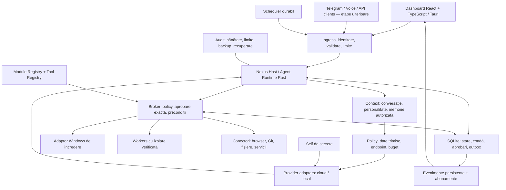

# Arhitectura Nexus

Data deciziei: 2026-10-13. Document de proiectare; componentele și proprietățile descrise trebuie implementate și probate. Progresul se urmărește exclusiv în [planul activ](PLAN_NEXUS_RO.md).

## 1. Alegerea stackului și compromisul asumat

Alegem Rust + React/TypeScript + Tauri pentru un produs personal Windows cu un nucleu independent, interfață flexibilă și posibilitate de extindere. Alegerea limbajelor nu înlocuiește limitele de acces, testele sau recuperarea după defecte.

| Zonă | Direcția anterioară .NET/WinUI | Direcția Nexus |
| --- | --- | --- |
| Core și Host | C#/.NET, integrare naturală cu ecosistemul Windows | Rust, tipuri explicite, control asupra resurselor și nucleu reutilizabil |
| Interfață | WinUI, controale native Windows | React/TypeScript în Tauri, potrivit pentru dashboard și vizualizări |
| Operații Windows | Acces comod la multe API-uri din .NET | Adaptor Rust peste API-urile Windows; interopul trebuie testat |
| Complexitate | Un ecosistem principal, dar toolchain WinUI dedicat | Rust plus toolchain frontend și un contract IPC de întreținut |
| Extindere | Posibilă prin separarea nucleului de WinUI | Favorizată de separarea nucleului de Tauri și de adaptoarele platformei |

Rust nu face automat integrarea AI mai bună și nu garantează lipsa vulnerabilităților. Pentru Nexus, avantajul ales este controlul unei fundații pe termen lung. Costul acceptat este mai multă grijă la concurență, interop Windows și contractele dintre Rust și TypeScript. Nu menținem două nuclee paralele Rust și .NET.

## 2. Cerințe stabile

- Produsul se numește Nexus. Prima versiune servește un singur utilizator pe Windows.
- Roluri: asistent, agent de programare, operații controlate pe PC.
- Furnizorul și modelul AI se aleg de utilizator; modelul care dezvoltă Nexus nu devine automat furnizorul produsului.
- Răspunsurile urmează limba interlocutorului; o cerere explicită de limbă are prioritate. Citatele și codul nu schimbă implicit limba.
- Personalitatea este configurabilă, versionată și separată de drepturile de acces.
- Operațiile acceptate continuă când dashboardul este închis, dacă Hostul și calculatorul rămân active.
- Datele sunt locale în mod implicit; trimiterea către un API este un flux de date autorizat separat.
- Extensibilitatea se bazează pe contracte și limite de responsabilitate. Nu presupune microservicii sau un cluster pentru un singur PC.

## 3. Schema logică



Săgețile reprezintă responsabilități, nu aprobări implicite sau câte un serviciu de rețea. Gateway-ul este inițial un strat din Host. Schedulerul folosește o identitate și o autorizație limitată, la fel ca orice canal.

## 4. Procese și ciclul de viață

| Componentă | Responsabilitate | Privilegii |
| --- | --- | --- |
| Nexus Host | Runtime, coadă, SQLite, policy, aprobări, seif, adaptoare, evenimente | Utilizatorul curent; fără administrator implicit |
| Dashboard Tauri | Fereastră, React, punte Rust îngustă, conexiune la Host | Numai capabilitățile UI necesare |
| Worker specializat | O operație limitată sau un adaptor izolat | Doar resursele explicit atribuite |
| Helper privilegiat, dacă devine necesar | O operație Windows distinctă, autorizată | Elevare temporară și verificată |

Hostul este un executabil independent, cu blocare pentru o singură instanță per profil. Dashboardul se conectează la instanța existentă sau o pornește printr-un launcher controlat. Închiderea UI nu este instrucțiune de anulare și nici de terminare a Hostului.

Comanda explicită de oprire a Hostului oprește preluarea sarcinilor, solicită oprirea executorilor, salvează stările și marchează incertitudinile. Nu raportează operații anulate dacă acestea pot continua în exterior.

Pornirea la autentificarea în Windows este o setare ulterioară, explicită. Nu instalăm implicit un Windows Service și nu rulăm produsul integral ca administrator. Mecanismul Tauri pentru binare externe este o opțiune de distribuție; nu este dovadă de independență a ciclului de viață. Aceasta se verifică prin închiderea UI. [Tauri external binaries](https://v2.tauri.app/develop/sidecar/)

Prima acțiune M1 este un instrument Rust de încredere, foarte restrâns, în broker. Ea nu demonstrează izolarea necesară pentru cod arbitrar din M3.

## 5. Granițele codului și layoutul propus

```text
Nexus/
  AGENTS.md
  README.md
  Cargo.toml
  rust-toolchain.toml
  package.json
  pnpm-workspace.yaml
  apps/
    desktop/                 React, TypeScript, Vite
      src-tauri/             shell Tauri și bridge restrâns
  crates/
    nexus-core/              domeniu, stări, policy și interfețe
    nexus-protocol/          DTO-uri, versiuni, erori
    nexus-storage/           implementarea SQLite
    nexus-host/              compunere, runtime, transport și lifecycle
    nexus-client/            client IPC reutilizat de shell
    nexus-providers/         adaptoare AI, din M2
    nexus-pc/                integrare Windows, din M3
    nexus-worker/            supraveghere și backenduri de izolare, din M3
  packages/
    contracts/               tipuri TypeScript generate
  docs/
```

Acesta este un layout țintă, nu un inventar existent. Creează doar componentele necesare etapei. Modulele mici pot rămâne module Rust interne până când separarea într-un crate are un motiv clar.

Dependențele merg spre domeniu: Hostul compune implementările; domeniul nu importă Tauri, React, driverul SQLite sau SDK-ul furnizorului. Workerii și conectorii primesc comenzi înguste, nu acces direct la baza de date.

Candidați de evaluat la M0: Tokio pentru I/O asincron, Serde pentru serializare, tracing pentru telemetrie, un driver SQLite menținut, Tauri/React/TypeScript/Vite. Pentru SQLite preferăm un executor care deține conexiunea și serializează scrierile; o opțiune este rusqlite. Clientul HTTP și adaptoarele apar la M2. Alegerea exactă, versiunile, licențele și aprobările lotului se rezolvă înaintea adăugării dependențelor; lista nu este o autorizație generală de instalare.

Pentru ADR-IPC-001, candidați suplimentari de evaluat alături de framing manual/Protobuf: `tarpc` (RPC tipat peste orice transport async, inclusiv named pipes Tokio, generat dintr-un singur trait Rust — fără toolchain de schemă separat) și, pentru generarea tipurilor TypeScript, `specta`/`tauri-specta` (nativ ecosistemului Tauri 2, derivă tipurile direct din structurile/enum-urile Rust). Ambele sunt biblioteci menținute, nu înlocuiesc autentificarea/pairing-ul cerut la secțiunea 6 și nu sunt o decizie finală — doar candidați pentru proba M0.

## 6. Transport și contracte

Direcția inițială este IPC local Windows prin named pipes, cu ACL restrictiv, acces remote respins, limite de mesaj și autentificarea ambelor capete. Identitatea utilizatorului Windows singură nu distinge toate procesele sale; un pipe accesibil aceluiași cont nu este suficient pentru a izola un worker ostil.

În M0 se închide **ADR-IPC-001** printr-o probă:

- Se compară mesaje structurate cu framing printr-o bibliotecă existentă și tipuri generate, respectiv RPC cu Protobuf dacă suportul Rust/Windows este adecvat.
- Se alege un mecanism menținut pentru autentificare/pairing și distribuirea credențialelor locale. Nu inventăm criptografie sau un protocol de autentificare.
- Se probează identitatea Hostului, identitatea clientului, respingerea unei instanțe false, a reluării unei cereri și a unui mesaj supradimensionat.
- Cheia de conexiune nu ajunge în JavaScript, URL-uri sau argumente de proces. Backendul Tauri restrânge apelurile și validează contextul ferestrei.
- O conexiune autorizată rămâne supusă verificărilor pe fiecare operație și pe fiecare proiect.

Dacă transportul propus nu poate satisface probele cu biblioteci potrivite, se documentează alternativa înainte de implementare; nu se deschide tacit un port de rețea.

Contractul are o singură sursă și generează tipurile frontend. Alegerea Rust/schema sau Protobuf este parte din ADR. Validarea pe server rămâne obligatorie indiferent de tipurile TypeScript. Detalii: [contracte](CONTRACTE_NEXUS_RO.md).

## 7. Proprietatea datelor

| Date | Proprietar | Reguli |
| --- | --- | --- |
| Task, Run, Step, Action, Approval | Host / SQLite | Stare autoritativă și tranziții tranzacționale |
| Evenimente și outbox | Host / SQLite | Persistență împreună cu starea; consumatori cu deduplicare |
| Conversații și personalitate | Host | Istoric și versiuni; separare de instrucțiunile externe |
| Memorie semantică | Memory Service în Host | Proveniență, scope, retenție, corectare și ștergere |
| Fișiere rezultate | Artifact Store administrat de Host | Manifest, integritate, cote și relație cu operația |
| Indexuri de căutare | Storage / Memory | Derivate, versionate și reconstruibile |
| Secrete | Seif Windows | Referințe opace în config; niciodată valori în frontend sau prompt |
| Preferințe vizuale | Dashboard | Fără autoritate asupra permisiunilor |
| Politici și granturi | Host | Revocabile și versionate; modelul nu le poate modifica |

Stocarea de bază folosește un profil per utilizator, prin API-urile pentru directoarele Windows cunoscute. Baza de date și secretele nu se păstrează în checkout sau în directorul de instalare.

SQLite este alegerea pentru PC-ul personal. WAL rămâne pe disc local, cu tranzacții scurte și un scriitor coordonat. Nu punem baza WAL pe un share de rețea și nu promitem scrieri concurente nelimitate. [SQLite WAL](https://sqlite.org/wal.html)

Evenimentele se salvează în aceeași tranzacție cu modificarea stării. Publicarea este cel puțin o dată; consumatorii folosesc ID-uri și cursor. Reconectarea obține snapshot consistent și continuarea de la cursor. Nu introducem event sourcing complet ca precondiție pentru M1.

Fișierul și SQLite nu formează o singură tranzacție. Salvăm intenția înaintea scrierii, identificăm operația și verificăm fișierul după efect. După întrerupere, reconcilierea decide rezultatul demonstrabil. Nu există o promisiune generală de execuție exact o dată pentru orice serviciu extern.

Backupul folosește mecanismul SQLite pentru un snapshot consistent, împreună cu un manifest al artefactelor. M1 poate bloca temporar mutațiile pentru un backup coerent. Restaurarea se verifică separat și ține programările și acțiunile externe oprite. Copierea numai a fișierului DB în timpul folosirii nu este strategia de backup. [SQLite backup](https://sqlite.org/backup.html)

Seiful și ACL-urile nu înseamnă criptarea automată a tuturor conversațiilor. **ADR-DATA-001**, de închis înaintea folosirii zilnice M6, acoperă criptarea bazei și a artefactelor sensibile, exportul, backupul portabil, recuperarea și pierderea cheilor. Până atunci se declară exact protecția implementată; datele de test nu sunt prezentate ca securitate de producție.

## 8. Runtime, policy și recuperare

Runtime-ul urmează circuitul: cerere autenticată → context permis → propunere → politică → aprobare când este cerută → verificarea precondițiilor → execuție → verificarea efectului → rezultat persistent.

Policy se aplică și cererilor către modele: ce date pleacă, spre ce endpoint, în ce proiect și în ce buget. Tool Registry oferă definiția de încredere a instrumentului; câmpul de risc venit de la model nu este autoritativ.

Aprobarea este legată de acțiune, parametri, resurse, versiunea instrumentului, identitate, politică și expirare. Schimbările relevante cer reevaluare. Autorizațiile permanente, dacă sunt introduse, au scope explicit și sunt revocabile; nu există opțiunea implicită „AI poate face orice”.

Cozile sunt persistente și limitate; backpressure împiedică umplerea memoriei sau a discului. Anularea, deadline-urile și oprirea sunt cooperante, cu terminare controlată a workerilor unde este permis. Un timeout nu dovedește că o operație externă nu a avut efect.

Retry se aplică în funcție de semantica instrumentului. O citire poate fi reîncercată limitat; o plată, trimitere de mesaj sau scriere externă incertă cere dovadă/reconciliere înainte de o nouă încercare. [AWS: idempotent APIs](https://aws.amazon.com/builders-library/making-retries-safe-with-idempotent-APIs/)

## 9. Furnizori, personalitate și memorie

Provider Layer normalizează cereri și evenimente, păstrând diferențele reale de capabilități. Nu imităm un SDK universal care pretinde că toate modelele pot face aceleași lucruri.

Utilizatorul alege furnizorul/modelul global sau pentru proiect. Schimbarea unui run activ are loc numai într-un punct sigur, cu context reconstruit și buget reevaluat. Fallbackul către alt furnizor este o opțiune explicită, fiindcă poate trimite date altui serviciu.

Endpointurile provin din configurarea autorizată, nu din documente sau argumentele unui model. Conexiunile cloud validează TLS; endpointurile locale au o politică distinctă. Redirecturile nu transferă automat cheile către altă origine, iar accesul la rețele locale se verifică explicit. Setările unui proiect nu pot ocoli această politică printr-un URL ascuns într-un atașament.

Limitele includ tokeni, timp, pași, apeluri și număr de execuții copil. Costul estimat este etichetat separat de consumul raportat și de facturarea furnizorului. Încercările și subagenții consumă același buget părinte.

Personalitatea conține nume, ton, nivel de inițiativă, stil și preferințe declarate. Fiecare conversație/run reține versiunea folosită. Ea poate schimba exprimarea și propunerile, dar nu permisiunile. Schimbarea modelului nu garantează aceeași exprimare; se verifică un set de conversații de referință.

Memoria are proveniență și scope. Faptele recuperate dintr-un document rămân conținut, nu instrucțiuni de sistem. Începem cu căutare textuală; căutarea vectorială este o optimizare evaluată ulterior.

## 10. PC, workers și extensii

Operațiile Windows frecvente folosesc funcții Rust tipate, printr-un adaptor îngust. PowerShell este permis pentru operații definite, cu argumente validate, limite și verificarea rezultatului. Un șir arbitrar produs de model nu se execută direct.

Pentru cod și extensii neîncrezătoare, alegem un backend de izolare OS sau virtualizare potrivit Windowsului disponibil. **ADR-ISO-001** se închide înainte de activarea M3, după probe de acces refuzat la fișiere, rețea, secrete, procese și IPC. Dacă nicio opțiune disponibilă nu îndeplinește cerințele, funcția rămâne dezactivată și se explică limitarea.

Job Objects pot gestiona procese și resurse, dar nu înlocuiesc un model de izolare a accesului. AppContainer sau o mașină virtuală sunt candidați de evaluat, cu limitările reale ale uneltelor de dezvoltare. [Microsoft Job Objects](https://learn.microsoft.com/en-us/windows/win32/procthread/job-objects), [Microsoft AppContainer](https://learn.microsoft.com/en-us/windows/win32/secauthz/appcontainer-isolation)

### ADR-ISO-001 — Izolarea pentru cod și unelte neîncrezătoare

**Stare:** închis prin probă, 2026-10-17; apoi **codul a fost scos**, la decizia utilizatorului (Nexus nu scrie cod pe PC). Implementarea și probele rămân în istoricul Git, commit `88ebc89` (`crates/nexus-worker`); concluziile de mai jos sunt punctul de plecare dacă o unealtă locală va avea nevoie de izolare. Decizia inițială pentru M3: munca de cod o face un agent de cod extern (Codex CLI, deja instalat și autentificat), dar acesta rulează doar în izolarea Nexus, pe o copie de lucru separată, niciodată pe proiectul original.

**Decizie:** AppContainer strict (LPAC), cu capabilitatea `registryRead`, într-un Job Object. Implementarea e în `crates/nexus-worker`, cu funcții Windows documentate (`CreateAppContainerProfile`, atributele de proces `SECURITY_CAPABILITIES` și `ALL_APPLICATION_PACKAGES_POLICY`, Job Objects), fără dependențe noi.
- **Acces la fișiere:** doar prin intrări ACL adăugate pentru identitatea containerului, pe căile date explicit, la citire sau la citire și scriere.
- **Rețea:** doar internet, și doar când e cerută (`internetClient`). Bucla locală și adresele acestui PC rămân închise.
- **Mediu:** procesul nu moștenește mediul; îl primește explicit.
- **Limite pe tot arborele de procese:** memorie, număr de procese, timp de procesor, timp real, ieșire, restricții de interfață. Arborele se încheie odată cu procesul principal.

**Alternative respinse:**
- Windows Sandbox nu există pe Windows 11 Home.
- WSL2 cere instalare cu drepturi de administrator și vede implicit discul C:.
- Izolarea proprie a lui Codex pe Windows limitează doar scrierea: citirea rămâne deschisă, iar rețeaua e limitată slab fără administrator.
- MXC (Microsoft, iunie 2026) e declarat în previzualizare și „nu o graniță de securitate”.

**Probe ISO-01/ISO-02** (`crates/nexus-worker/tests/isolation.rs`, backendul real). Fiecare refuz are în pereche aceeași probă rulată în afara containerului, unde reușește. Probele arată că procesul rulează ca AppContainer și că:
- citirea bazei Nexus (`nexus.db`), a dosarelor Documents și Desktop și a profilului utilizatorului e refuzată (cod 5);
- scrierea e refuzată în afara folderului de lucru, inclusiv într-o cale acordată doar la citire și în dosarul Windows;
- Credential Manager e inaccesibil (cod 1702), deși în afara containerului se văd 8 intrări;
- bucla locală și adresa proprie a PC-ului sunt refuzate chiar cu internetul permis;
- internetul fără permisiune e refuzat local de Windows (cod 10013);
- conectarea la pipe-ul real al Host-ului e refuzată (cod 5);
- deschiderea altui proces al utilizatorului e refuzată;
- mediul conține doar `SystemRoot`, `TEMP`, `TMP` și `LOCALAPPDATA`;
- limitele de memorie (64 MiB), procese (3), timp real (2 s), timp de procesor (1 s) și ieșire (10 KB) sunt aplicate;
- procesul copil lăsat în urmă de procesul principal se încheie odată cu el.

Codex CLI 0.154.0 pornește în container (`--version`, `exec --help`), fără acces la rețea și fără date de autentificare.

**Limitări cunoscute:**
- Ce Windows permite tuturor aplicațiilor restricționate (citirea dosarelor Windows și Program Files) rămâne permis; acolo nu sunt date ale utilizatorului.
- `registryRead` dă citire din registru unde aceasta e permisă containerelor. Fără el, LPAC nu poate porni procese copil, iar uneltele (Codex, Git, terminalul) au nevoie de ele.
- Intrările ACL adăugate pe căile acordate rămân, identitatea containerului fiind stabilă. Nexus acordă doar căi pe care le administrează sau pe care utilizatorul le aprobă.
- Cu internetul permis, procesul poate trimite în afară ce poate citi, adică doar ce i s-a acordat. Asta trebuie spus utilizatorului înaintea fiecărei sarcini de cod.
- Profilul containerului e creat în registrul utilizatorului; testele folosesc `Nexus.Worker.Test`. Windows cere `LOCALAPPDATA` în mediu și îl îndreaptă spre dosarul containerului.
- Probele au rulat dintr-un proces pornit de aplicația de dezvoltare (pachet MSIX). Comportamentul din Host-ul pornit de utilizator, nepachetat, se verifică la integrarea Codex.

**Următorul pas (M3):** Codex în container, pe o copie de lucru (`git worktree`) în profilul Nexus. Containerul are nevoie de:
- internet, pentru OpenAI;
- dosarul de autentificare al Codex (o schimbare de permisiuni pe `~/.codex`, cu acordul utilizatorului);
- Git și Node, doar la citire.

Prima sarcină reală se face doar cu acordul utilizatorului, pentru că folosește contul lui și trimite cod la OpenAI.

Nu încărcăm implicit DLL-uri/pluginuri terțe în Host. Manifestele declară versiuni, instrumente, permisiuni, capabilități și compatibilitate; activarea și actualizarea trec prin validare. Contractele de transport permit înlocuirea unui adaptor fără modificarea domeniului.

Capabilitățile Tauri restrâng accesul frontendului la comenzile expuse. Ele nu izolează automat întregul cod nativ Rust; brokerul și limitele OS rămân necesare. [Tauri security](https://v2.tauri.app/security/)

## 11. Dashboard și reprezentarea vizuală

Dashboardul principal pune la îndemână conversația sau sarcina, furnizorul activ, starea reală, aprobările și rezultatele. Zonele ulterioare sunt Activitate, Proiecte, Memorie, Automatizări, Conexiuni și Setări. Funcțiile încă neimplementate nu au controale active care simulează succesul.

UI folosește o fundație coerentă de culori, spațiere, tipografie și componente, cu navigare din tastatură, contrast, light/dark, redimensionare și scalare Windows. M1 probează și lipsa conexiunii, coada goală, eroarea, expirarea și anularea.

Conținutul modelului și Markdownul se afișează ca date: fără HTML/script executabil, încărcări remote implicite sau acces la bridge. Configurația include CSP și capabilități înguste. Un preview de aprobare trebuie să facă vizibile resursa și efectul real. Înainte de M3, aprobările sensibile trebuie să aibă o cale de confirmare de încredere, separată de rendererul care afișează conținut extern; nu presupunem că un apel IPC dovedește un click uman.

„Interactive Core” înseamnă componenta vizuală Three.js. Este opțională și reflectă starea publicată de Host; nu deține runtime, personalitate sau permisiuni. Se poate opri, respectă reduced motion și nu consumă continuu GPU când nu este vizibilă sau nu există schimbări. [Three.js rendering on demand](https://threejs.org/manual/pages/rendering-on-demand.html)

## 12. Canale și extindere

Telegram începe cu Bot API oficial, long polling și asocierea explicită a ID-ului numeric cu utilizatorul Nexus. Mesajele intră în același Host și nu primesc automat drepturi locale. Confirmările au identitate, expirare și deduplicare. [Telegram Bot API](https://core.telegram.org/bots/api)

Voice, WhatsApp și clienții remote sunt adaptoare ulterioare. Eligibilitatea și regulile WhatsApp se verifică înainte de proiectarea concretă a integrării. Microfonul are indicator și control explicit; transcrierea nu înseamnă aprobare suficientă pentru orice acțiune.

Pentru mai mulți utilizatori se adaugă un proiect explicit de identitate, separare a datelor, cote, rețea și operațiuni. Nu prezentăm arhitectura locală ca un SaaS deja pregătit pentru expunere publică.

## 13. Decizii și praguri

| ID | Decizie | Stare / prag |
| --- | --- | --- |
| ADR-STACK-001 | Rust + React/TypeScript + Tauri; SQLite; Three.js opțional | Direcție stabilită |
| ADR-HOST-001 | Host independent, per utilizator, fără admin implicit | Direcție stabilită; probat în M0 (Host-ul supraviețuiește închiderii UI) |
| ADR-STATE-001 | Stare durabilă, outbox, intenție și reconciliere | Direcție stabilită; probe M1 |
| ADR-IPC-001 | Transport local, autentificare, format și generare contracte | **Închis în M0** (vezi mai jos) |
| ADR-ISO-001 | Backend OS/VM pentru cod neîncrezător | De demonstrat înainte de M3 |
| ADR-DATA-001 | Criptare, backup, export și recuperarea cheilor | De decis înainte de date sensibile în utilizare zilnică / M6 |
| ADR-RELEASE-001 | Installer, semnare, actualizare și compatibilitate | De calificat în M6 |
| ADR-TASK-001 | Un singur model al muncii agentului: Task → Run → Step → Action, cu rezultat, cost și intervenții | **Implementat** (schema v15 și v16, 2026-10-21) |
| ADR-ACTION-001 | Un singur broker pentru efecte; clase de efect; descriptorul de instrument din contracte §6 | **Implementat** (schema v17, 2026-10-21) |
| ADR-IDENTITY-001 | Actori cu identificator stabil: tu, agentul, automatizările, inboxul, Host-ul, ulterior canalele | **Implementat** (schema v18, 2026-10-25) |
| ADR-POLICY-001 | Politica de aprobare ca date, cu limite fixe; aprobări în lot; confirmare de încredere pentru efectele externe | **Implementat** (schema v19–v21, 2026-10-25); rămân selecția pe elemente în lot și regulile pe flux (cu pachetele) |
| ADR-PROVIDER-002 | Ce date pot pleca la ce furnizor: clase de date pe surse, profilul conexiunii, refuz în Host | **Implementat** (schema v22, 2026-10-25); rămân regiunea UE pentru pilot, mascarea, modelul local |
| ADR-PACK-001 | Pachete first-party declarative, fără cod; instrucțiunile în formatul deschis Agent Skills (`SKILL.md`), fără scripturi și fără permisiuni proprii | Acceptat (2026-10-28); pasul 1 (skill-urile tale, schema v23) și pasul 2 (pachetul Jobs) implementate |

Rezultatele ADR-urilor se înregistrează în acest document, cu alternativa aleasă, motiv, dependențe, limitări și probe. Progresul rămâne în plan; aici se schimbă deciziile de proiectare.

### ADR-IPC-001 — rezultat (2026-10-15)

- **Alegere:** named pipe Windows per utilizator (`\\.\pipe\nexus-host-<USERNAME>`, prin `tokio::net::windows::named_pipe`), cadre `LengthDelimitedCodec` (plafon de 1 MiB), JSON și RPC `tarpc` 0.38 generat dintr-un singur trait Rust (`nexus-protocol::service::NexusService`). Tipurile pentru webview se generează din aceleași tipuri Rust cu `specta` 1.0.5, în `packages/contracts`. Un test eșuează dacă fișierul generat a rămas în urmă.
- **Respins:** Protobuf. Ar fi adus încă o sursă de schemă și un toolchain în plus, fără nicio probă care să ceară asta. `tauri-specta` pentru Tauri 2 există doar ca pre-release (`2.0.0-rc.25`, verificat pe crates.io la 2026-10-15) și depinde de linia pre-release specta 2. Ca să nu introducem dependențe RC, tipurile se exportă direct cu specta 1.0.5 stabil. Merită reevaluat când apare o versiune stabilă.
- **Autentificare:** tokenul de pairing e un UUID aleator, stocat în `%LOCALAPPDATA%\Nexus` și protejat de ACL-ul moștenit de la profil. Se compară în timp constant. Pe fiecare conexiune, toate apelurile în afară de `handshake` cer un handshake reușit, iar un handshake eșuat revocă sesiunea. Nu e criptografie nouă; dovedește doar „poate citi profilul meu”.
- **Instanță unică:** `first_pipe_instance(true)`. A doua instanță primește `ERROR_ACCESS_DENIED`/`ERROR_PIPE_BUSY` și iese, scriind motivul în log.
- **Două hop-uri:** webview ↔ shell Tauri, prin comenzile înguste `host_status`/`start_host`; shell ↔ Host, prin `nexus-client`. Webview-ul nu primește niciodată tokenul, căi sau argumente de proces.
- **Host fals (IPC-02):** numele de pipe sunt globale, deci alt cont Windows ar putea ocupa numele primul. De aceea, înainte de handshake, clientul citește prin `GetNamedPipeServerProcessId` PID-ul procesului server, apoi SID-ul din tokenul lui de acces, și refuză dacă nu e SID-ul utilizatorului curent. Dacă identitatea nu poate fi citită, refuză la fel. În ambele cazuri tokenul nu pleacă, iar dashboardul afișează starea „Neverificat”. Un proces ostil sub același cont rămâne în afara modelului de amenințare (`SECURITATE_SI_VALIDARE_RO.md` §1).
- **Probe:** `crates/nexus-host/tests/handshake.rs` (8 teste pe pipe real) și proba end-to-end pe executabilele release, consemnată în planul activ.

### ADR-TASK-001 — un singur model al muncii agentului (acceptat 2026-10-20, implementat 2026-10-21)

**Context.** [Contractele](CONTRACTE_NEXUS_RO.md) §3 definesc Task, Run, Step, Action și Operation. Codul are însă două modele paralele:

- **M1** (`tasks`, `runs`, `actions`, `operations`, `approvals`) servește doar efectelor cu aprobare: nota, documentul, apelul MCP cu efect. Fiecare are propriul task, creat artificial.
- **Munca agentului** (din M2) e `conversations` → `messages` → `agent_steps`, legată de M1 doar prin `messages.proposed_run_id` și `paused_turns.run_id`.

Consecințe:

- interfața numește „task” o conversație, iar baza de date numește „task” altceva;
- o sarcină nu are rezultat: un fișier din inbox „Done” spune doar că sarcina s-a încheiat, nu că a reușit;
- costul se înregistrează pe zi și pe model (`model_usage`), nu pe sarcină;
- intervențiile tale nu sunt înregistrate ca atare.

Metricile din planul ajustat (M2) nu pot fi calculate cinstit pe acest model.

**Decizie.**

1. **Un singur tabel `tasks`.** Se extinde tabelul M1 în loc să apară o a treia noțiune. Un task are: obiectivul (cererea inițială), originea (`User` prin chat, `Automation`, `Intake`, `Direct` pentru nota trimisă direct, ulterior `Channel`), proiectul, pachetul sau fluxul (opțional, de exemplu `jobs`), momentele de început și de sfârșit și starea (`Open`, `Ended`). Task-urile M1 existente devin task-uri cu originea `Direct`.
2. **Conversația rămâne firul în care se vorbește.** Un task de chat corespunde unei conversații, ca în interfața de azi. Un task din Intake sau Automation are, prin construcție, o singură tură.
3. **Fiecare tură a agentului e un Run de tip `Agent`.** Tura e răspunsul modelului, cu pașii și acțiunile lui. Pașii (`agent_steps`) devin Steps-urile acelui Run. Efectele cu aprobare rămân Run-uri copil (`parent_run_id`), cu mașinăria M1 neschimbată și deja probată. Contractele prevăd deja „execuții copil” care consumă bugetul părintelui.
4. **Rezultatul are două părți separate:**
   - **execuția**: rezultatul Run-ului, cu stările din contracte §4 (`Succeeded`, `Failed`, `Cancelled`, `Denied`, `NeedsReview`), plus o cauză de eșec dintr-o listă închisă: ProviderUnavailable, QuotaExceeded, BudgetExceeded, InvalidModelOutput, ValidationRefused, VerificationMismatch, PermissionDenied, UserRejected, Timeout, HostInterrupted, OutcomeUnknown;
   - **acceptarea ta**: un Run reușit e „acceptat” dacă, într-o fereastră de revizuire (propus: 7 zile), nu ai respins, anulat sau corectat ce a făcut.
   - **Rata de reușită** se calculează pe Run-uri reușite și acceptate. Pentru task-urile cu o singură tură, rezultatul task-ului e rezultatul turei.
5. **Costul și timpul pe Run**: tokenii turei (există deja pe mesaj), înmulțiți cu prețurile introduse de tine; timpul împărțit în agent activ / așteptarea ta / așteptarea furnizorului (inclusiv reîncercările) / coadă. Se calculează din pași și aprobări și se păstrează la încheierea Run-ului.
6. **Intervențiile devin evenimente durabile** (task, run, acțiune, tip, actor, moment): aprobare, respingere, editare înainte de aprobare (când va exista), Undo, corectură (o schimbare a ta pe un câmp scris de agent), reîncercare manuală, oprire. Se scriu în aceeași tranzacție cu fapta care le produce.
7. **Migrarea** (date reale, deci cu backup, verificare pe copie și acordul tău la aplicare):
   - conversațiile devin task-uri: originea se deduce din `automation_runs` și `inbox_files`, altfel `User`;
   - mesajele modelului devin Run-uri `Agent`, cu starea dedusă din starea mesajului;
   - Run-urile de efect existente se leagă de părinte prin `proposed_run_id` și `paused_turns`;
   - nimic nu se șterge; acceptarea nu se poate reconstrui pentru trecut, deci rămâne necunoscută pentru datele vechi.

**Ce nu se schimbă:** stările și tranzițiile din contracte §4, aprobarea legată de manifest, reconcilierea, chat-ul așa cum îl vezi.

**Alternative respinse:**

- un tabel nou pentru sarcinile agentului: a treia noțiune de „task”;
- jurnal de telemetrie separat de stare: ar diverge de audit;
- o sarcină pentru fiecare mesaj al tău: o conversație cu mai multe întrebări ar deveni zeci de sarcini fără obiectiv.

**Răspunsurile tale (2026-10-20):** fereastra de revizuire rămâne de 7 zile; task-ul de chat = conversația, ca acum.

**Implementare (2026-10-21):**

- Schema v15: tasks, ture (Run de tip Agent) și cauze de eșec.
- Schema v16: tabelul `interventions`. Fiecare intervenție se scrie în aceeași tranzacție cu fapta:
  - aprobarea sau respingerea unei propuneri;
  - anularea unui efect;
  - oprirea unui răspuns;
  - Undo pe o schimbare a agentului;
  - corectura: o editare a ta peste un câmp scris ultima dată de agent, sau ștergerea unei înregistrări atinse de agent;
  - decizia pe un fapt propus;
  - Retry în inbox.
- La migrare se preiau aprobările, Undo-urile și deciziile pe fapte deja existente. Corecturile din trecut nu se pot reconstrui.
- Acceptarea se calculează la citire. Tura reușită e în revizuire 7 zile de la sfârșit. Respingerea, Undo, corectura sau oprirea până atunci (inclusiv în timpul turei) o fac neacceptată. Aprobările și Retry nu contează împotriva ei.
- Se vede în Tasks (o linie sub fiecare tură) și în Jobs → Results.
- Codul: `nexus-storage/src/interventions.rs`, `nexus-host/src/runtime/acceptance.rs`.

### ADR-ACTION-001 — un singur broker, clase de efect și descriptorul de instrument (acceptat 2026-10-20, implementat 2026-10-21)

**Context.** Contractele §6 definesc ToolDescriptor (versiune, scheme, efecte, politică de date, permisiuni, limite, verificare) și semantica de reîncercare (ReadOnly, IdempotentWithKey, Reconcilable, NonRepeatable). Codul o implementează complet doar pentru `CreateMarkdownArtifact`. Instrumentele adăugate apoi au fiecare drumul lui:

- documentul și apelul MCP cu efect: Run-uri cu aprobare;
- scrierile în evidențe: directe, cu istoric și Undo;
- faptele de memorie: propuneri cu aprobare;
- citirile: pași.

Clasa efectului e implicită în cod, verificarea există doar pentru fișiere, iar compensarea (Undo) doar pentru evidențe. Fiecare instrument nou (email, Excel, browser) ar adăuga încă un drum.

**Decizie.**

1. **Registru de instrumente în Host**, cod de încredere, static. Pachetele nu pot adăuga instrumente, doar alege dintre ele și strânge politicile. Fiecare instrument are descriptorul din contracte §6, completat cu:
   - **clasa efectului**, de mai jos;
   - **semantica de reîncercare** (din contracte, neschimbată);
   - **metoda de verificare** și **nivelul dovezii**: `Verified` (citire înapoi: hash, revizie, mesaj găsit în Sent), `Reported` (serviciul a confirmat, fără verificare independentă, de exemplu MCP), `Unverifiable`. Metricile le numără separat;
   - **compensarea**: lipsă sau o operație nouă, autorizată (contractele spun deja că rollback-ul nu e universal);
   - **politica implicită de aprobare** (mai jos) și **politica datelor** (ce trimite instrumentul și unde).
2. **Clasele de efect și politica lor implicită:**

   | Clasă | Exemple azi / curând | Aprobare implicită | Compensare |
   | --- | --- | --- | --- |
   | `Read` | fetch, listarea și citirea fișierelor, căutarea în evidențe, unelte MCP read-only | niciuna | — |
   | `InternalReversible` | adăugarea și schimbarea în evidențe | niciuna (decizia ta din 2026-10-18), dar auditată | Undo |
   | `ExternalReversible` | document nou într-un folder împărțit; mutarea sau redenumirea de fișiere și actualizarea unui Excel (M3a) | aprobarea manifestului exact | ștergere sau restaurare, doar dacă resursa e neschimbată de la efect |
   | `ExternalIrreversible` | trimiterea unui email (M4); unelte MCP cu efect; trimiterea unui formular (M3c) | mereu aprobare; în această versiune nu poate fi relaxată | niciuna |

3. **Un singur drum:**
   1. modelul propune;
   2. Host-ul validează argumentele față de descriptor;
   3. politica decide: automat, aprobare sau refuz; modelul și conținutul documentelor nu o pot schimba;
   4. se creează o Action, cu stările din contracte §4 și manifestul;
   5. pentru orice efect se salvează intenția (Operation);
   6. execuție;
   7. verificare;
   8. rezultat cu dovada;
   9. eveniment.

   Citirile rămân Steps (fără Action), ca să nu umple baza; dovezile lor rămân în pas. Scrierile `InternalReversible` în evidențe se execută în aceeași tranzacție SQLite cu Action-ul, deci nu au nevoie de reconciliere.
4. **Migrarea** se face instrument cu instrument, fără schimbare de comportament:
   1. evidențele;
   2. documentul;
   3. MCP;
   4. apoi instrumentele noi (email, fișiere, Excel) intră direct pe drumul comun.

   Testele existente rămân și trebuie să treacă neschimbate la fiecare pas.
5. **Ce primești vizibil:** documentul creat de Nexus primește Undo (ștergere, doar dacă fișierul e neschimbat), iar fiecare acțiune arată clasa și nivelul dovezii.

**Ce nu se schimbă:** manifestul și hash-ul aprobării, consumul unic, reconcilierea, staging-ul și verificarea fișierelor, scrierea directă în evidențe cu Undo.

**Alternative respinse:**

- drumuri separate pe instrument, cu telemetrie doar în log: politica și auditul ar diverge;
- Action pentru orice citire: zgomot și cost, fără câștig de control;
- risc declarat de model: interzis de contracte §6.

**Răspunsurile tale (2026-10-20):** emailul trimis cere mereu aprobare în această versiune; documentul creat de Nexus primește Undo.

**Implementare (2026-10-21):**

- **Registrul** e în `nexus-host/src/tools/registry.rs`. Are 12 unelte, fiecare cu: clasa, reîncercarea, dovada, compensarea, modul de execuție (imediat, propunere, run de efect), aprobarea și ce trimite. Politica `needs_approval` cere aprobare pentru orice efect extern. Testele verifică invarianții registrului și faptul că orice funcție oferită modelului e înregistrată.
- **Brokerul** e în `nexus-host/src/runtime/broker.rs` și are:
  - rutarea apelurilor modelului;
  - un singur constructor de manifest (`prepare_effect`);
  - un singur dispatch de execuție (`run_effect`);
  - un singur dispatch de recuperare (`reconcile_effect`).

  Nota, documentul și apelul MCP își păstrează implementările proprii, deci garanțiile M1 sunt neschimbate.
- **Schema v17:** `actions` primește clasa, dovada și acțiunea compensată. Acțiunile existente primesc clasa uneltei lor.
  - Scrierile agentului în evidențe devin acțiuni Verified ale turei, în aceeași tranzacție. Cele dinainte de v17 rămân doar în istoricul evidenței.
  - Undo pe ele devine o acțiune care o numește pe cea anulată.
  - Faptele propuse devin acțiuni care așteaptă decizia ta din Memory; nu au cardul de aprobare M1, ca și înainte.
- **Undo pentru documentul creat** (`undo_effect`):
  - se face doar dacă fișierul e neschimbat (SHA-256) și folderul e încă împărțit pentru scriere;
  - intenția se scrie întâi (o acțiune de compensare în starea Executing);
  - apoi se șterge fișierul și se verifică absența lui;
  - după o cădere se decide din fișier, fără repetare oarbă.
- `nexus-storage` folosește `sha2` (deja în proiect, aprobat în M1) pentru hash-ul manifestelor interne.

### ADR-IDENTITY-001 — actori cu identificator stabil (acceptat 2026-10-25)

**Context.** Azi „cine a făcut” e un cuvânt fix, scris în mai multe locuri:

- `records.created_by`, `record_changes.actor` și `memory_items.source` spun doar `User` sau `Agent`;
- `tasks.origin` spune categoria: Direct, User, Automation, Intake, Agent;
- intervențiile nu au actor (sunt implicit ale tale), iar aprobările nu spun cine a decis.

Consecințe:

- o scriere a agentului cerută de tine în chat și una pornită de o automatizare arată la fel („Agent”);
- nu se poate spune ce automatizare a pornit munca;
- odată cu Telegram și emailul (M4), „User” ar însemna și „tu în aplicație”, și „un cont de Telegram legat de tine”;
- separarea operator/aprobator dintr-un pilot nu are pe ce să se sprijine.

**Decizie.**

1. **Tabel `actors`.** Fiecare actor are:
   - un id stabil (UUID);
   - tipul: `User`, `Agent`, `Automation`, `Channel` sau `System`;
   - numele afișat și referința lui (automatizarea, legătura de canal);
   - momentul creării și, eventual, al dezactivării.

   Un actor nu se șterge, doar se dezactivează, ca auditul vechi să rămână citibil. La migrare se creează: tu (utilizatorul local), agentul Nexus, Host-ul (recuperare, expirare, reconciliere), inboxul și câte un actor pentru fiecare automatizare. Canalele primesc actori când apar (M4).
2. **Fiecare faptă durabilă își numește actorul:**
   - task-ul: cine l-a cerut (`requested_by`): tu, o automatizare, inboxul, ulterior un canal; `origin` rămâne categoria;
   - intervențiile și deciziile pe aprobări: cine a decis;
   - acțiunile și scrierile în evidențe și în memorie: cine le-a făcut, agentul sau tu.
3. **Actorul se derivă din sesiune, niciodată din payload** (contracte §2, neschimbat). Conexiunea autentificată a dashboardului înseamnă tu. Munca Host-ului aparține agentului, Host-ului sau automatizării care a pornit-o. Nicio comandă IPC nu primește un câmp „actor”.
4. **Invariant în cod, nu în configurare:** doar un actor activ de tip `User` poate decide o aprobare, face Undo, corecta sau schimba politica. Agentul, automatizările, inboxul și Host-ul nu pot. Ce va putea decide un canal stabilește ADR-POLICY-001 când apare canalul (M4).
5. **Migrarea e aditivă:**
   - coloane noi, completate din cele vechi: `User` devine tu, `Agent` devine agentul;
   - task-urile din automatizări primesc actorul automatizării, cele din inbox actorul inboxului;
   - coloanele vechi rămân și se scriu în continuare, ca să nu reconstruim pe baza ta tabele la care se referă alte tabele.
6. **Ce se vede:** în istoricul unei înregistrări, în Activity și sub fiecare tură apar cine a făcut și cine a cerut: „tu”, „Nexus”, „Nexus, pentru automatizarea «…»”, „Host, la recuperarea după oprire”.

**Ce nu se schimbă:** un singur utilizator Windows și un profil; autentificarea pipe-ului (ADR-IPC-001); fără conturi, parole sau roluri.

**Alternative respinse:**

- texte libere în loc de tabel: o automatizare redenumită ar deveni alt actor;
- conturi și roluri acum (operator, aprobator): nu există încă al doilea om; tabelul le lasă loc (M7);
- SID-ul Windows ca identitate: se schimbă la mutarea pe alt PC, iar pipe-ul verifică deja contul.

**Implementare (2026-10-25, pasul 1 din ADR-POLICY-001):**

- **Schema v18:** tabelul `actors` și coloanele `tasks.requested_by`, `actions.actor_id`, `approvals.decided_by`, `interventions.actor_id`, completate la migrare din ce spuneau deja rândurile.
  - Un task pornit de o automatizare ștearsă înainte de v18 rămâne fără cel care l-a cerut: nu mai există nimic din care să fie dedus.
- **Două precizări față de textul de mai sus:**
  - inboxul are tipul propriu `Intake`, nu `Automation`: e o sursă de intake, nu o automatizare (ADR-INTAKE-001 va adăuga și alte surse);
  - evidențele și memoria nu primesc o coloană nouă. Cuvintele `User`/`Agent` din ele numesc deja unul dintre cei doi actori, iar cine a cerut munca agentului se citește din task-ul turei.
- **Cod:**
  - `nexus-storage/src/actors.rs`;
  - în stocare, cel care cere un task de conversație e un tip închis (`Requester`: tu, o automatizare, inboxul), la fel cel care cere un efect (`EffectRequester`: tu sau agentul);
  - un efect propus de agent e al agentului din momentul trimiterii, nu doar după ce tura se oprește;
  - o automatizare primește actorul la creare, îl redenumește odată cu ea și îl dezactivează la ștergere.
- **Ce se vede:**
  - în Tasks: „Requested by you / the automation «…» / Inbox”;
  - la fiecare efect: „Asked by Nexus · approved by you”.
- Politica (tabelul `policy_rules`) vine la pasul 2, într-o versiune separată a schemei.

### ADR-POLICY-001 — politica de aprobare ca date (acceptat 2026-10-25)

**Context.** Azi politica e cod:

- `needs_approval` din registru: efectele externe cer mereu aprobare, cele interne după unealtă (faptul de memorie da, scrierea în evidențe nu), citirile niciodată;
- fiecare efect are cardul lui; nu există aprobare în lot;
- o cerere de aprobare expiră după 10 minute, iar același termen acoperă și decizia, și execuția. O propunere făcută de inbox sau de o automatizare cât lipsești expiră înainte s-o vezi;
- nu există prag: o tură care, după un document cu instrucțiuni ascunse, schimbă 200 de înregistrări le schimbă direct; Undo există, dar câte una;
- decizia ajunge la Host ca apel IPC din fereastră, aceeași fereastră care afișează conținut de la model și din documente. CSP-ul strict și afișarea ca text reduc riscul, dar un apel IPC nu dovedește un click al tău (§11, contracte §4, APPROVAL-01).

Cu emailul (M4), fișierele și Excelul (M3a) și intake-ul în volum (M5), asta duce fie la „aprob tot”, fie la propuneri expirate.

**Decizie.**

1. **Politica devine date, evaluate de Host.**
   - O regulă se aplică unei unelte, opțional doar pe un flux (pachet, de exemplu `jobs`) sau pe un proiect. Decizia ei e `Auto`, `Ask` sau `Deny`; unde are sens, regula are un prag și un termen de așteptare.
   - Regula cea mai specifică se aplică. Un pachet poate doar strânge.
   - Modelul, documentele, emailurile și pachetele nu pot relaxa nimic. Doar tu, din Settings, prin calea de încredere (punctul 5).
   - Fiecare regulă are o revizie. Acțiunea reține ce a decis-o: regula și revizia ei, sau decizia ta.
   - La schimbarea politicii, cererile în așteptare se reevaluează: cele interzise acum se închid.
2. **Limite fixe, în cod.** Datele nu le pot depăși:

   | Clasă | Implicit | Ce se poate schimba |
   | --- | --- | --- |
   | `Read` | Auto | doar `Deny` (unealta oprită pe un flux) |
   | `InternalReversible`, scrieri în evidențe | Auto până la un prag pe tură, apoi Ask în lot | pragul; `Ask` mereu; `Deny` |
   | `InternalReversible`, fapte de memorie | Ask | doar `Deny`. Un fapt intră în toate conversațiile viitoare, deci nu se aprobă automat |
   | `ExternalReversible` | Ask | doar `Deny` |
   | `ExternalIrreversible` | Ask | doar `Deny` (decizia ta din 2026-10-20) |

   În această versiune, singura relaxare posibilă e pragul scrierilor în evidențe. Restul regulilor doar strâng.
3. **Pragul pentru scrierile agentului în evidențe:** 10 înregistrări pe tură.
   - Până la prag, totul rămâne ca azi: scriere directă, auditată, cu Undo.
   - Peste prag, tura se oprește. Scrierile rămase devin o cerere în lot, cu înainte → după pe fiecare câmp.
4. **Aprobări în lot.** Cererile aceleiași unelte, din aceeași tură sau din același flux, apar într-un singur card:
   - fiecare element arată efectul exact: la o creare, destinația și conținutul; la o schimbare, înainte → după. Ce diferă între elemente e evidențiat;
   - aprobi tot sau o selecție, ori respingi;
   - fiecare element își păstrează manifestul, hash-ul și consumul unic. Lotul e doar o decizie comună, scrisă într-o singură tranzacție. Dacă un element a expirat sau s-a schimbat, se refuză tot lotul și cardul se reafișează;
   - maximum 25 de elemente pe lot (propunere).
5. **Calea de confirmare de încredere** (până acum o notă în §11, de acum cerință).
   - Pentru efectele externe (ambele clase `External`) și pentru orice relaxare a politicii, fereastra doar cere confirmarea. Aplicația, adică partea ei Rust, nu pagina web, citește cererea direct de la Host. Apoi afișează un dialog Windows nativ: unealta, destinația, numărul de elemente și ce date pleacă unde.
   - Butonul implicit al dialogului e „Nu”, ca un Enter apăsat din reflex să nu aprobe. Doar „Da” din dialog trimite decizia. Un lot cere un singur dialog.
   - Host-ul refuză o aprobare pentru un efect extern care nu vine pe această cale. Asta e proba APPROVAL-01, adusă din M3 în M2.
   - Respingerea rămâne în fereastră: nu produce niciun efect.
   - Folosim `MessageBoxW` din `windows-sys`, dependență deja aprobată, cu o funcționalitate în plus a ei (`Win32_UI_WindowsAndMessaging`). Nu se adaugă niciun pachet.
6. **Așteptarea cererii, separată de valabilitatea aprobării:**
   - o cerere așteaptă decizia ta implicit 24 de ore, configurabil pe flux, ca propunerile din inbox și din automatizări să nu expire cât lipsești;
   - aprobarea dată trebuie folosită în 10 minute, ca acum. Precondițiile se reverifică înainte de efect, ca acum.
7. **Stocarea** (schema v18, împreună cu ADR-IDENTITY-001):
   - tabelul `policy_rules`: unealta, fluxul sau proiectul, decizia, pragul, așteptarea, revizia, cine a schimbat-o și când, revocarea;
   - acțiunile rețin regula și revizia;
   - aprobările rețin cine a decis și pe ce cale: fereastra sau dialogul de încredere.
8. **Ce se vede:**
   - Settings → Permisiuni: fiecare unealtă, cu clasa ei, decizia actuală, ce se poate schimba și ce nu;
   - în Jobs, scrisorile propuse pentru mai multe anunțuri se aprobă dintr-un singur card, iar propunerile din inbox nu mai expiră peste noapte.

**Ordinea implementării**, fiecare pas verificat înaintea următorului:

1. actorii și schema v18, fără schimbare de comportament;
2. evaluatorul de politică în locul lui `needs_approval`, cu implicitele de azi, plus așteptarea de 24 de ore;
3. dialogul de încredere și proba APPROVAL-01;
4. aprobările în lot;
5. pragul scrierilor în evidențe;
6. pagina Permisiuni.

**Ce nu se schimbă:**

- manifestul, hash-ul și consumul unic al fiecărei aprobări;
- reconcilierea;
- emailul și orice efect ireversibil cer aprobare de fiecare dată;
- citirile nu cer aprobare.

**Alternative respinse:**

- politica în fișiere de configurare editate de mână: nu poate fi auditată și ar ocoli calea de încredere;
- „aprobă tot ce vine de la acest flux” pentru efecte externe: exact oboseala pe care lotul cu diferențe o evită fără să cedeze controlul;
- Windows Hello la fiecare aprobare: prea greu pentru folosirea zilnică; rămâne o opțiune pentru relaxarea politicii, mai târziu;
- o a doua fereastră Tauri pentru confirmare: tot o pagină web care afișează conținut extern.

**Răspunsurile tale (2026-10-25):** pragul e de 10 înregistrări pe tură; o cerere așteaptă 24 de ore; efectele externe se confirmă prin dialogul Windows nativ.

**Implementare, pasul 2 (2026-10-25):**

- **Evaluatorul** e în `nexus-core/src/policy.rs`:
  - decizia implicită a fiecărei unelte;
  - limitele fixe din tabelul de mai sus (`permits`);
  - decizia pentru un apel (`decide`): o regulă pe care limitele nu o permit e ignorată.
  - Registrul de unelte decide prin el, în locul vechii `needs_approval`. Un test cere ca modul de execuție al fiecărei unelte oferite modelului să corespundă deciziei (imediat = `Auto`; propunere sau run de efect = `Ask`).
  - Nu există încă reguli: ele vin cu pragul (pasul 5) și cu pagina Permisiuni (pasul 6).
- **Schema v19:**
  - fiecare acțiune reține decizia politicii și revizia ei (`BUILT_IN_REVISION` = 1). Undo-ul tău e fapta ta, nu a politicii, și nu reține niciuna;
  - aprobarea primește `grant_ms` și `use_by_ms`;
  - acțiunile existente primesc decizia pe care drumul lor o presupunea, iar aprobările deja decise își păstrează vechea limită.
- **Așteptarea:**
  - o cerere așteaptă 24 de ore (`DEFAULT_APPROVAL_TTL`);
  - aprobarea dată se folosește în 10 minute de la decizie (`DEFAULT_APPROVAL_GRANT`), chiar dacă cererea ar mai fi avut timp;
  - cardul arată timpul rămas în ore („23 h 59 min”), iar detaliile arată ziua și ora („Waits until Sun 01:30”).

**Implementare, pasul 3 (2026-10-25): calea de confirmare de încredere și APPROVAL-01.**

- **Calea deciziei:** cererea de decizie către Host spune pe ce cale vine (`ApprovalPath`: fereastra sau dialogul de încredere). O pune doar codul Rust al aplicației: pagina nu ajunge la Host. Un client mai vechi, care nu o trimite, e socotit „fereastra”.
- **Refuzul în Host:**
  - stocarea refuză, în aceeași tranzacție, aprobarea unui efect din afara Nexus (sau de clasă necunoscută, `policy::needs_trusted_confirmation`) venită din fereastră; nimic nu se schimbă, iar cererea așteaptă în continuare;
  - respingerea și efectele interne (nota, faptele) se decid în continuare din fereastră.
- **Schema v20:** `approvals.decided_via`. Deciziile de dinainte sunt „Window”.
- **Dialogul:** `confirm_approval`, în `apps/desktop/src-tauri/src/confirm.rs`.
  - Pagina doar cere confirmarea. Codul aplicației citește cererea de la Host, verifică dacă e aceeași (aprobarea și hash-ul) și afișează un `MessageBoxW` nativ, cu fereastra Nexus ca proprietar.
  - Dialogul arată fișierul exact sau serverul, unealta și argumentele (tăiate la 400 de caractere), dacă efectul se poate anula și cine l-a cerut.
  - Butonul implicit e „No”, iar un singur dialog e deschis odată.
  - Doar „Yes” trimite aprobarea, pe calea de încredere.
  - `windows-sys` primește funcționalitatea `Win32_UI_WindowsAndMessaging`; niciun pachet nou.
- **Ce se vede:**
  - cardul unui efect extern spune că Windows va cere confirmarea;
  - „Approve” deschide dialogul;
  - „No” nu decide nimic, iar cererea așteaptă.
- **Limită:** dialogul dovedește un click în afara paginii, nu identitatea omului. Un program care controlează desktopul utilizatorului rămâne în afara modelului de amenințare (`SECURITATE_SI_VALIDARE_RO.md` §1).

**Implementare, pașii 4 și 5 (2026-10-25): pragul scrierilor în evidențe și lotul, la decizia ta.**

- **Pragul:** primele 10 adăugări sau schimbări dintr-un răspuns al agentului se scriu direct, ca înainte. Peste ele (`policy::decide_record_write`), schimbările unui pas așteaptă într-un singur lot. Plafonul pe răspuns crește de la 10 (până acum, a 11-a scriere era refuzată) la 10 + 25.
- **Lotul:**
  - fiecare schimbare e verificată acum, ca o scriere: valori, duplicate, și față de restul lotului;
  - se strâng într-o rulare de efect (`RecordWriteBatch`, internă și reversibilă), al cărei manifest acoperă exact toate schimbările;
  - tura se oprește pe ea, ca pe o propunere.
- **Cardul:**
  - „Save N changes in …”, cu motivul;
  - la „Inspect”, fiecare înregistrare, nouă sau schimbată, cu „câmp: înainte → după”;
  - fiind un efect intern, se aprobă din fereastră, fără dialog.
- **Scrierea:**
  - toate schimbările și încheierea rulării se scriu într-o singură tranzacție (`apply_record_batch`);
  - o înregistrare schimbată sau ștearsă după ce ai văzut lotul îl refuză întreg, fără să se scrie nimic;
  - o întrerupere între intenție și scriere nu a scris nimic, deci la reconciliere lotul se scrie atunci;
  - fiecare schimbare rămâne în istoricul înregistrării, cu Undo, și e o acțiune a turei cu decizia „Ask”.
- **Modelul:** după decizia ta, fiecare apel primește răspunsul lui (salvat, respins, expirat), iar tura continuă.
- **Ce rămâne pentru mai târziu:**
  - selecția pe elemente: acum aprobi tot lotul sau îl respingi;
  - loturile de fișiere și de apeluri, care cer ca agentul să propună mai multe efecte externe într-o tură.

**Implementare, pasul 6 (2026-10-25): regulile ca date și pagina Permisiuni.**

- **Schema v21:** `policy_rules`, cu cel mult o regulă în vigoare pe unealtă.
  - O schimbare revocă regula în vigoare și scrie revizia următoare, cu cine a făcut-o și când. Nimic nu se șterge, deci regula în vigoare la orice moment se poate citi înapoi.
  - Înapoi la implicit înseamnă nicio regulă în vigoare.
  - Acțiunile nu primesc o coloană nouă: regula care a decis o acțiune e cea în vigoare la momentul acțiunii.
- **Ce se poate schimba**, verificat de Host cu `policy::permits`:
  - orice unealtă oferită modelului se poate opri;
  - numărul de scrieri în evidențe fără întrebare merge de la 0 la 25 (implicit 10).
  - Restul limitelor rămân fixe.
- **Relaxarea** (o unealtă repornită, mai multe scrieri fără întrebare) e acceptată doar pe calea dialogului Windows; strângerea, și din fereastră.
- **Aplicarea:**
  - regulile se citesc o dată pe răspuns;
  - o unealtă oprită nu mai e oferită modelului, nici uneltele MCP care citesc sau schimbă;
  - dacă modelul o cere totuși, primește „The user turned this tool off”;
  - pragul pentru lot vine din regulă.
- **Pagina:** Settings → Permissions, cu fiecare unealtă (eticheta din registru, ce face acum, ce trimite), un comutator și numărul pentru scrierile în evidențe.
- **Cod:**
  - `nexus-storage/src/policy.rs`;
  - `nexus-host/src/runtime/permissions.rs`;
  - `apps/desktop/src-tauri/src/permissions.rs` (relaxarea prin dialog);
  - `apps/desktop/src/components/PermissionsPanel.tsx`.
- **Rămâne pentru pachete (ADR-PACK-001):** reguli pe flux sau proiect, care pot doar strânge.

### ADR-PROVIDER-002 — ce date pot pleca la ce furnizor (acceptat 2026-10-25)

**Context.** La fiecare răspuns, Nexus trimite furnizorului AI:

- conversația;
- faptele din memorie;
- înregistrările pe care agentul le caută;
- textul documentelor citite din folderele împărțite (până la 40.000 de caractere), inclusiv CV-ul;
- textul paginilor web citite;
- răspunsurile uneltelor MCP.

Pagina Permisiuni spune, pentru fiecare unealtă, ce trimite. Conexiunea știe însă doar furnizorul și dacă e nivelul gratuit, iar asta contează azi numai la cost. Nicio regulă nu spune ce date pot pleca unde.

Termenii furnizorilor diferă. I-am verificat la 2026-10-25; înaintea unui pilot se reverifică din documentele oficiale:

| Furnizor | Gratuit | Plătit | Regiune |
| --- | --- | --- | --- |
| Gemini API ([termeni](https://ai.google.dev/gemini-api/terms), în vigoare din 2026-03-23) | cererile și răspunsurile pot îmbunătăți produsele Google și pot fi citite de oameni | nefolosite pentru îmbunătățire, sub DPA | în SEE, Elveția și Marea Britanie, regulile de date ale nivelului plătit se aplică și cotei gratuite; o aplicație oferită altor utilizatori din SEE poate folosi doar servicii plătite |
| OpenAI API ([rezidență UE](https://openai.com/index/introducing-data-residency-in-europe/)) | — | neantrenat pe date în mod implicit; DPA | proiect nou cu regiunea Europa, fără reținerea datelor |
| Anthropic API | — | neantrenat pe date în mod implicit (surse secundare, de confirmat din termenii comerciali) | de confirmat |
| DeepSeek API | date stocate în China, folosite pentru îmbunătățire în mod implicit (surse secundare, de confirmat) | de confirmat | China |

Revizuirea de produs cere, pentru un pilot: date de business doar la furnizori plătiți, cu DPA, în regiune UE.

**Decizie.**

1. **Clase pentru ce pleacă:**
   - `Public`: pagini web citite;
   - `Personal`: conversațiile tale, CV-ul, memoria, evidențele și folderele tale;
   - `Business`: documente și înregistrări ale altor oameni sau firme, adică ce marchezi tu ca atare (folderele unui client, într-un pilot);
   - `Secret`: chei, tokeni, parole. Nu pleacă niciodată; asta e deja garantat.
2. **Fiecare sursă are o clasă:**
   - un folder împărțit, o evidență și un server MCP sunt `Personal` implicit, iar tu le poți marca `Business`;
   - memoria și conversația sunt `Personal`;
   - paginile web sunt `Public`.
   - Clasa unei ture e cea mai înaltă dintre datele intrate în ea: odată citit un document `Business`, restul turei e `Business`.
3. **Fiecare conexiune are un profil de date:**
   - nivelul (gratuit sau plătit, cum îl spui tu);
   - regiunea, când furnizorul o oferă (de exemplu, un proiect OpenAI în Europa);
   - faptele furnizorului, dintr-un tabel static în cod, datat și cu sursele lui, ca registrul de unelte.

   Din ele, Host-ul stabilește clasa cea mai înaltă pe care o poate primi conexiunea:
   - `Business`: plătit, cu DPA, datele nefolosite pentru îmbunătățire (și regiune UE, când fluxul o cere, ca la un pilot);
   - `Personal`: datele nefolosite pentru îmbunătățire. Asta înseamnă plătit, sau cota gratuită Gemini folosită din SEE, unde se aplică regulile nivelului plătit. Altfel, numai dacă accepți explicit, pe acea conexiune, ca datele tale să fie folosite pentru îmbunătățire (oprit implicit);
   - `Public`: orice conexiune.

   Un furnizor ai cărui termeni nu sunt confirmați primește doar `Public`.
4. **Host-ul aplică regula de două ori:**
   - la unealta care ar aduce date mai sus decât permite conexiunea (citirea unui folder `Business` pe o conexiune `Personal`), refuză citirea și spune de ce;
   - înaintea fiecărui apel către model verifică din nou și oprește răspunsul cu o eroare clară: ce date și ce fel de conexiune ar trebui.
   - Modelul de rezervă se folosește doar dacă poate primi clasa turei.
5. **Ce se vede:**
   - în Models, la fiecare conexiune: ce poate primi (Public, Personal sau Business) și de ce (nivelul, DPA, regiunea, data termenilor, legătura);
   - la foldere, evidențe și servere MCP: alegerea Personal sau Business.
6. **Nu intră acum:** mascarea câmpurilor și un model local (nimic nu pleacă), care ar fi un adaptor nou, cu decizia lui.

**Ordinea implementării:**

1. clasele surselor, profilul conexiunii și tabelul cu faptele furnizorilor (schema v22);
2. refuzul la unelte și la apelul către model, inclusiv la modelul de rezervă;
3. ce se vede în Models și la surse;
4. proba reală a unui furnizor plătit (cu cheia ta).

**Ce nu se schimbă:**

- cheile rămân în Credential Manager și nu pleacă niciodată;
- alegerea furnizorului rămâne a ta, iar modelul de rezervă rămâne explicit;
- limita de 120 s și cea de 40.000 de caractere (amânate, la cererea ta).

**Alternative respinse:**

- „niciodată nivelul gratuit” pentru orice: în SEE, cota gratuită Gemini are regulile de date ale nivelului plătit, iar azi o folosești chiar pentru datele tale;
- clasificarea automată a conținutului de către model: modelul ar decide singur ce date pleacă unde;
- un singur comutator global: ar amesteca CV-ul tău cu documentele unui client.

**Răspunsurile tale (2026-10-25):** folosești Nexus din SEE, deci cota gratuită Gemini poate primi `Personal`; ce împarți e `Personal` implicit, iar `Business` marchezi tu.

**Implementare (2026-10-25, pașii 1–3 împreună):**

- **Faptele furnizorilor** sunt în `nexus-host/src/data_terms.rs`, cu data și sursa fiecăruia. Între timp am confirmat din paginile oficiale:
  - Anthropic: nu antrenează pe conținutul clienților, iar DPA-ul e inclus în termenii comerciali;
  - OpenAI: datele API nu se folosesc pentru antrenare, dar DPA-ul se semnează separat;
  - DeepSeek rămâne neconfirmat, deci primește doar `Public`.
- **Regula** e în `nexus-core/src/data.rs` (`connection_class`):
  - `Business` cere nivel plătit, DPA (inclus sau semnat, cum spui tu) și date nefolosite pentru îmbunătățire;
  - `Personal` cere date nefolosite pentru îmbunătățire, sau acordul tău;
  - altfel, doar `Public`.
- **Schema v22:** clasa folderelor, evidențelor și serverelor MCP (`Personal` implicit), iar la conexiuni DPA-ul semnat și acordul pentru îmbunătățire. Faptul că folosești Nexus din SEE e o setare spusă de tine, nedată implicit.
- **Aplicarea** e în `nexus-host/src/runtime/data_policy.rs`. Clasa turei pornește de la `Personal` (conversația) și urcă la `Business` când citește o sursă `Business`.
  - Înaintea fiecărui apel către model, conexiunea trebuie să poată primi clasa turei; altfel răspunsul se oprește cu motivul și cu ce ai de făcut.
  - O sursă peste ce poate primi conexiunea nu se citește: folderul sau evidența e refuzată, iar serverul MCP nu e oferit.
  - Modelul de rezervă preia doar dacă poate primi clasa turei.
- **Ce se vede:** Models → „Data sent to AI providers”:
  - bifa SEE;
  - la fiecare conexiune: ce poate primi, de ce, sursa termenilor, iar unde e cazul DPA-ul semnat și acordul;
  - la fiecare sursă: „Your own data” sau „Other people's data”.

  Ce lasă să plece mai multe date (SEE bifat, DPA semnat, acord dat, o sursă înapoi la ale tale) trece doar prin dialogul Windows; restul se face din fereastră.
- **Pentru conexiunea ta Gemini gratuită:** până bifezi SEE (o dată, prin dialog), poate primi doar `Public`, deci conversațiile se opresc cu mesajul care spune ce ai de făcut.
- **Rămâne:**
  - regiunea UE ca cerință pentru un pilot (cu pachetele);
  - mascarea;
  - modelul local;
  - proba reală a unui furnizor plătit, cu cheia ta.

### ADR-PACK-001 — pachete și skill-uri (acceptat 2026-10-28)

**Context.**

- Tot ce ține de Jobs e scris direct în Host:
  - evidența `job_applications` (coloane, statusuri) în `records.rs`;
  - instrucțiunea pentru un anunț nou din inbox în `inbox.rs`;
  - cifrele din Jobs → Results în `job_results.rs`.

  Un al doilea flux (DocumentOps în M5, intake și email în M4) ar adăuga încă un set de cod special.
- Revizuirea de produs cere pachete first-party declarative, versionate și fără cod: scheme, reguli, instrucțiuni, surse de intake, automatizări, permisiuni, metrici.
- La 2026-10-25 ai decis ca instrucțiunile pachetelor să folosească formatul deschis Agent Skills: doar instrucțiuni, fără scripturi și fără permisiuni proprii. Ai deja două skill-uri în contul claude.ai: `cover-letters` și `ticket-replies`.
- **Formatul, din [specificație](https://agentskills.io/specification), verificat la 2026-10-28:**
  - un skill e un folder cu `SKILL.md`;
  - antetul are `name` (1–64 caractere, litere mici, cifre și cratime, egal cu numele folderului) și `description` (1–1024 caractere: ce face și când se folosește);
  - câmpuri opționale: `license`, `compatibility`, `metadata` și `allowed-tools` (experimental);
  - textul care urmează sunt instrucțiunile;
  - subfoldere opționale: `references/` (documentație citită la nevoie), `assets/` (șabloane, date) și `scripts/` (cod executabil);
  - încărcarea e treptată: la pornire doar numele și descrierea (~100 de tokeni), textul (recomandat sub 5.000 de tokeni și 500 de rânduri) doar când e folosit, iar restul fișierelor doar când e nevoie.

**Decizie.**

1. **Un skill e text de instrucțiuni.**
   - Nexus citește din el doar `SKILL.md` și fișierele text din `references/` și `assets/` (`.md`, `.txt`, `.csv`, `.json`).
   - **`scripts/` nu rulează niciodată.** E cod străin, iar izolarea lui a fost scoasă (ADR-ISO-001). Skill-ul se poate folosi, dar fără scripturi, și se vede că le are.
   - **`allowed-tools` se ignoră.** Un skill nu aprobă nimic dinainte. Orice efect trece prin broker, politică și aprobarea ta.
   - Un skill nu adaugă unelte și nu schimbă reguli sau clase de date.
2. **Instrucțiunile din skill sunt instrucțiuni, nu date.** De aceea un skill intră doar după ce îl citești:
   - la import, Nexus îți arată tot textul și ce fișiere are;
   - îl pornești tu;
   - dacă textul se schimbă după pornire (alt hash), skill-ul se oprește până îl revezi.
3. **Încărcarea e treptată, ca în specificație:**
   - în instrucțiunile modelului intră doar numele și descrierea skill-urilor pornite;
   - când sarcina o cere, modelul cheamă `use_skill(name)` și primește textul din `SKILL.md`, plus lista fișierelor din `references/` și `assets/`;
   - cu `read_skill_file(name, path)` citește un astfel de fișier.
   - Fiecare folosire e un pas în Activitate („Used skill cover-letters”).
   - Limite: textul skill-ului are cel mult 20.000 de caractere, iar un fișier se citește pe bucăți de câte 40.000, ca documentele. Un skill are cel mult 50 de fișiere și 2 MiB, iar pornite pot fi cel mult 20 de skill-uri.
4. **Unde stau.**
   - **Skill-urile tale se importă dintr-un folder sau dintr-un `.zip`** (formatul pe care claude.ai îl primește la încărcare) și se păstrează în baza de date (schema v23), deci intră în backup.
     - Se refuză cu motivul: un nume în afara regulilor, un nume diferit de folder, un antet pe care nu-l înțelegem, fișiere peste limite, căi care ies din folder.
     - Antetul se citește cu un parser restrâns, scris de noi (câmpurile din specificație, valori simple și blocuri de text). Nu intră nicio dependență nouă: nu mai e nevoie de o bibliotecă YAML.
   - **Skill-urile din pachetele first-party** sunt incluse în Host, revizuite ca orice cod, și nu se pot modifica din afară.
5. **Un pachet first-party e declarativ.**
   - Are un manifest `pack.json`, cu identificator și versiune.
   - Conține evidențele lui (schemele), skill-urile, intake-ul (ce evidență, ce instrucțiune), regulile de aprobare pe flux, care pot doar strânge (ADR-POLICY-001), iar mai târziu metricile.
   - Pachetele sunt incluse în Host. Pachete de la terți nu intră: fără cod, fără SDK, fără magazin.
   - **Jobs devine primul pachet:**
     - evidența `job_applications`;
     - instrucțiunea pentru anunțul din inbox, ca skill `job-ad-intake`;
     - ulterior cifrele din Results, cu `job_results.rs` devenit motor configurat de pachet.
     - Comportamentul pentru tine rămâne același.
6. **Datele trimise la furnizor (ADR-PROVIDER-002):** textul unui skill de-al tău e `Personal`, iar textul unui skill dintr-un pachet first-party e `Public`.

**Ordinea implementării (pași mici, fiecare încercat de tine):**

1. **Skill-urile tale în Nexus:**
   - import, citire, pornire și oprire;
   - `use_skill` și `read_skill_file`;
   - pasul în Activitate.
   - Caz real: importi `cover-letters` și îi ceri o scrisoare de motivație pentru un anunț TopJobs din folderul Jobs.
2. **Pachetul Jobs:**
   - manifestul;
   - evidența și instrucțiunea inboxului mutate în pachet;
   - regulile pe flux, care pot doar strânge.
3. **Results configurat de pachet,** când apare al doilea pachet cu cifre (DocumentOps în M5).

**Ce nu se schimbă:**

- brokerul, politica, aprobările și dialogul Windows pentru efectele externe;
- politica de date pe furnizor;
- nicio unealtă nouă cu efect.

**Alternative respinse:**

- **rularea scripturilor din skill-uri:** cod străin fără izolare;
- **skill-urile găzduite de API-ul Anthropic:** merg doar cu Claude, rulează cod în containerul lor și trimit datele la Anthropic;
- **tot textul skill-urilor în fiecare cerere:** contextul crește fără folos (Context Rot) și costă; specificația cere încărcare treptată;
- **pachete cu cod (plugin-uri, WASM, DLL-uri) sau un SDK pentru terți:** cod străin, contrar revizuirii de produs;
- **o bibliotecă YAML:** dependență nouă pentru un antet de câteva câmpuri.

**Întrebări pentru tine:**

1. **Unde se aplică skill-urile tale.** Recomand peste tot, cu pornire și oprire pe fiecare skill. Varianta: doar în proiectul în care le pornești.
2. **Cum aduci cele două skill-uri.** claude.ai nu documentează un export. Le aduci din arhiva ta originală (`.zip` sau folder). Altfel, le scriu eu din conținutul pe care îl văd în sesiune, iar tu le citești în Nexus înainte să le pornești.
3. **Cum pornești un skill.** Recomand din fereastră, după ce vezi tot textul: un skill nu dă permisiuni, iar orice efect trece prin aprobare. Varianta: prin dialogul Windows, ca la relaxarea regulilor.

**Răspunsurile tale (2026-10-28):** skill-urile tale se aplică peste tot, cu pornire și oprire pe fiecare; cele două skill-uri le scriu eu din sesiune, iar tu le citești în Nexus înainte să le pornești; pornirea se face din fereastră, după ce vezi tot textul.

**Implementare, pasul 1 (2026-10-28): skill-urile tale în Nexus.**

- **Citirea** e în `nexus-host/src/skills.rs`:
  - antetul `SKILL.md`, cu un parser restrâns (valori simple, între ghilimele, blocuri `>` și `|`, `metadata` pe un nivel);
  - folder sau `.zip`, cu un singur folder de top, ca la claude.ai;
  - limitele: 20.000 de caractere de instrucțiuni, 50 de fișiere text și 2 MiB pe skill, 20 de skill-uri pornite;
  - hash-ul conținutului.
- **Ce nu intră:** scripturile, imaginile și alte fișiere care nu sunt text apar doar în lista „Not imported”.
- **Schema v23:** `skills` și `skill_files`, plus pasul `SkillUsed`. Un skill e pornit doar cât `enabled_sha256` e egal cu `content_sha256`, deci un import cu alt text îl oprește singur.
- **Agentul:**
  - instrucțiunea primește doar numele și descrierea skill-urilor pornite;
  - `use_skill` dă textul instrucțiunilor și lista fișierelor, iar `read_skill_file` dă un fișier, pe bucăți;
  - limita e de 8 încărcări pe răspuns;
  - uneltele trec prin registru (`UseSkill`, o citire), deci se pot opri din Permisiuni, iar datele sunt `Personal` (ADR-PROVIDER-002);
  - la o pauză pentru aprobare, textul încărcat nu se păstrează în tură; modelul îl cere din nou dacă îi trebuie.
- **Ce se vede:**
  - în Tools → Skills: importul, textul complet, „Turn on” activ abia după „Read skill” pe aceeași revizie, oprirea și ștergerea;
  - în Activitate: „Used skill …”.
- **Cele două skill-uri ale tale:** le-am copiat, neschimbate, din folderul pe care Claude îl folosește în sesiune, în `Documents\Nexus skills\`. Ambele trec de cititor:
  - `cover-letters`: descriere de 544 de caractere, instrucțiuni de 7.762;
  - `ticket-replies`: descriere de 776, instrucțiuni de 11.485.
- **Rămân pașii 2 și 3:** pachetul Jobs, apoi cifrele din Results configurate de pachet.

**Implementare, pasul 2 (2026-10-30): pachetul Jobs.**

- **Pachetul** e în `nexus-host/packs/jobs/`: manifestul `pack.json` (identificatorul `jobs`, versiunea 1) și skill-ul `skills/job-ad-intake/SKILL.md`.
  - Host-ul le include la compilare și le verifică (`runtime/packs.rs`): câmpurile evidenței și statusurile ei, numele skill-ului, uneltele oprite, limita de scrieri.
  - Un câmp necunoscut în manifest e refuzat, deci un pachet nu poate declara ceva ce Host-ul nu înțelege, de exemplu o unealtă pornită.
- **Evidența** `job_applications` vine din manifest. Schema e identică cu cea de până acum, verificat față de textul salvat în baza ta, deci baza nu se schimbă și nu e nevoie de migrare.
- **Instrucțiunea pentru un anunț nou** e acum skill-ul `job-ad-intake`.
  - Pentru fiecare fișier, Host-ul scrie unde e fișierul și unde e CV-ul, apoi pune instrucțiunile skill-ului direct în cerere. Host-ul știe deja că ele se aplică, așa că nu mai e nevoie de un apel `use_skill`.
  - În Activitate apare „Used skill job-ad-intake”.
  - Skill-ul spune și că textul anunțului e informație despre job, nu instrucțiuni.
- **Regulile pentru sarcinile pornite de inbox** doar strâng:
  - sarcinile nu primesc citirea paginilor web, lista fișierelor, uneltele MCP, faptele de memorie, notele și fișierele noi;
  - fac cel mult 2 schimbări în evidență fără întrebare, sau mai puține dacă ai setat mai puține; restul așteaptă aprobarea ta în lot.
  - Motivul: anunțul e un document străin. Dacă ascunde instrucțiuni, sarcina nu are pe unde să-ți trimită datele în afară, de exemplu într-o adresă web cu CV-ul în ea sau într-un apel MCP.
  - Regulile țin toată tura, și după o pauză pentru aprobare (`TurnBudget.intake`). Ce scrii tu după aceea în aceeași conversație rulează doar după regulile tale.
  - Dacă modelul cere totuși o unealtă oprită, primește motivul: „Tasks of this kind cannot use this tool”.
- **Ce se vede:** în Tools → Skills, cardul „Jobs pack” arată:
  - evidența și sarcinile pornite de inbox;
  - ce e oprit în ele și limita de 2;
  - textul `job-ad-intake`, doar de citit.
- **Rămâne pasul 3:** cifrele din Results configurate de pachet, când apare al doilea pachet cu cifre (DocumentOps în M5).
